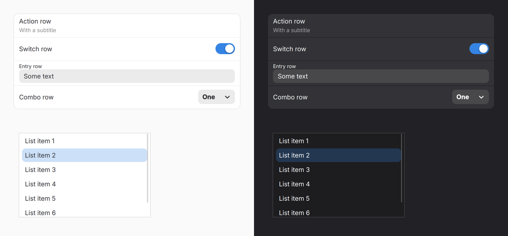

<div align="center">

# qt-libadwaita

**Make Qt apps look like they belong on GNOME.**

A Qt style plugin that draws Qt 6 and Qt 5 widgets the way libadwaita 1.10 (GNOME 51) does:
light and dark, nine accent colours, high contrast, all following your desktop settings live.


</div>

## Why

Qt apps on GNOME (or on a GNOME-styled KDE desktop) stick out: different buttons, different lists, different
menus. Existing Qt themes imitate the old GTK 3 Adwaita. This one follows **current libadwaita**: its colours are
generated from libadwaita's own stylesheet tokens, and every widget is checked against screenshots of real GTK 4
widgets (see [tests/visual/report/REPORT.md](tests/visual/report/REPORT.md)).

## Features

- **The libadwaita look**: rounded buttons and pills, flat entries, switches, rounded list rows, overlay scroll
  bars that fade out, popover-style menus with soft shadows, AdwTabBar tabs, header bars and boxed lists.
- **Follows the desktop**: light/dark, accent colour and high contrast come from the XDG desktop portal (GNOME)
  or the KDE colour scheme (Plasma), and switch live without restarting apps.
- **Qt 6 and Qt 5** from the same sources; public Qt API only, so one build loads in any newer Qt 6.
- **KDE colour schemes** included (Libadwaita, Libadwaita Dark and both high-contrast variants), so KDE apps such
  as Dolphin and Kate paint their sidebars and views in the same colours.
- **GTK behaviour where it matters**: mnemonic underlines only while Alt is held, focus rings only from the
  keyboard, Adwaita Sans as the UI font.
- **Adjustable**: spacing (compact to comfortable) and font size, for layouts that were not designed for GNOME
  metrics.
- **Flatpak apps** too: the installer shares the plugin with Flatpak apps through a user override.



<table>
<tr>
<td width="50%"><br><sub>Accent colours follow the system setting</sub></td>
<td width="50%"><br><sub>High contrast, light and dark</sub></td>
</tr>
</table>

## Install

```sh
git clone https://github.com/SeniorMatt/qt-libadwaita.git
cd qt-libadwaita
./install.sh --enable
```

This builds the plugin for Qt 6 (and Qt 5 if available) and installs it into `~/.local`: no root needed. If
cmake, a compiler or the Qt 6 development packages are missing, the script prints the exact command for your
distribution. No compiler? Download a prebuilt tarball from the
[Releases](https://github.com/SeniorMatt/qt-libadwaita/releases) page and run its `./install.sh --enable`.
Update with `git pull && ./install.sh`, remove with `./install.sh --remove`.

Per-distribution packages, Flatpak apps, `--system`, and the immutable KDE Linux route: [docs/install.md](docs/install.md).

### Turn it on

| Where | How |
|---|---|
| KDE Plasma | System Settings > Colours & Themes > Application Style: **Libadwaita**, and Colours: **Libadwaita** or **Libadwaita Dark** |
| One app | `QT_STYLE_OVERRIDE=Libadwaita myapp` or `myapp -style Libadwaita` |
| Whole session | `QT_STYLE_OVERRIDE=Libadwaita` in `~/.config/environment.d/qt.conf` |

KDE apps paint their content areas from the KDE colour scheme, so pick **Libadwaita** or **Libadwaita Dark**
in Colours as well (`install.sh` installs both).

**KDE Plasma, everything at once:** `install.sh` also installs two complete Global Themes (colours, style, window
decoration, Adwaita icons, Plasma style, splash, fonts). Switch with one click: *System Settings > Colours & Themes >
Global Theme > Libadwaita* (or *Libadwaita Dark*). Details: [docs/plasma.md](docs/plasma.md).

## Fonts

GNOME uses **Adwaita Sans** for the interface and **Adwaita Mono** for code. `install.sh` installs both into
`~/.local/share/fonts` (Flatpak apps see them there too); distros also ship them as `adwaita-fonts` /
`fonts-adwaita`.

Qt widget apps (Dolphin, Kate, qBittorrent...) get Adwaita Sans from the style itself, at the size set by
`font-size` (default 10, see [Configure](#configure)). Everything else (Plasma, QML apps such as Discover and System
Settings, GTK apps) uses the desktop font settings, so set those to match.

**KDE Plasma: System Settings > Text & Fonts > Fonts** (called just *Fonts* in older Plasma), press *Adjust All
Fonts...* or set each line:

| Plasma setting | Font | Size (style default `font-size=10`) | Size for exact GNOME (`font-size=11`) |
|---|---|---|---|
| General | Adwaita Sans, Regular | 10 | 11 |
| Fixed width | Adwaita Mono, Regular | 10 | 11 |
| Small | Adwaita Sans, Regular | 8 | 9 |
| Toolbar | Adwaita Sans, Regular | 10 | 11 |
| Menu | Adwaita Sans, Regular | 10 | 11 |
| Window title | Adwaita Sans, **Bold** | 10 | 11 |

Rendering, on the same page, as GNOME does it:

| Setting | Value |
|---|---|
| Anti-Aliasing | Enabled |
| Sub-pixel rendering | None (GNOME uses grayscale) |
| Hinting | Slight |
| Force font DPI | Off (scale the display instead) |

Plasma passes these fonts on to GTK apps automatically. Keep *General* and the style's `font-size` the same, or
widget apps and QML apps will show different text sizes side by side.

**GNOME:** nothing to do. GNOME already defaults to Adwaita Sans 11 and Adwaita Mono 11; for an exact match set
`font-size=11` in `~/.config/qt-libadwaita.conf`. To keep each app's own font instead, set
`ADWAITA_KEEP_APP_FONT=1` (or `font-size=0`).

## Configure

Everything follows the desktop by default. To override, use `~/.config/qt-libadwaita.conf`:

```ini
[General]
spacing=comfortable   # compact | normal | comfortable | any number 0.5-3
font-size=11          # Adwaita Sans size; default 10, 11 = exact GNOME size, 0 = keep the app's font
bold-labels=true      # button labels: true (bold, as libadwaita) | semibold | false
```

or environment variables:

| Variable | Values |
|---|---|
| `ADWAITA_COLOR_SCHEME` | `light`, `dark` |
| `ADWAITA_ACCENT` | `blue`, `teal`, `green`, `yellow`, `orange`, `red`, `pink`, `purple`, `slate`, `#rrggbb` |
| `ADWAITA_HIGH_CONTRAST` | `0`, `1` |
| `ADWAITA_ANIMATIONS` | `0`, `1` |
| `ADWAITA_SPACING`, `ADWAITA_FONT_SIZE`, `ADWAITA_BOLD_LABELS` | as in the config file |
| `ADWAITA_KEEP_APP_PALETTE`, `ADWAITA_KEEP_APP_FONT` | `1` keeps the app's own palette or font |

## For app developers

Widgets can ask for GTK style classes through a dynamic property:

```cpp
saveButton->setProperty("adwaita-class", "suggested-action");   // accent button
deleteButton->setProperty("adwaita-class", "destructive-action");
toggle->setProperty("adwaita-switch", true);                     // QCheckBox drawn as a switch
```

Also available: `flat`, `pill`, `headerbar`, `boxed-list` / `boxed-row`. Without them apps still get the
libadwaita look; the classes only add the variants GTK apps choose explicitly. Full table and all options in [docs/configuration.md](docs/configuration.md).

## Tested with

Dolphin, Kate, qBittorrent, VLC (Qt 5), OBS Studio (menus and dialogs; OBS draws the rest with its own theme) and
Kinoklip. Telegram Desktop links Qt statically and ignores style plugins.

## How close is it?

[`tests/visual/compare/run.sh`](tests/visual/compare) renders every widget with this style and with real GTK 4 / libadwaita,
in four schemes and two accents, and scores the difference. Current results and the known gaps are in
[tests/visual/report/REPORT.md](tests/visual/report/REPORT.md) and [docs/status.md](docs/status.md). The main ones:
no backdrop (unfocused window) state yet, and window title bars come from the window manager, not the style.

## Credits

Small helpers adapted from [adwaita-qt](https://github.com/FedoraQt/adwaita-qt) and
[Breeze](https://invent.kde.org/plasma/breeze); settings handling informed by
[QGnomePlatform](https://github.com/FedoraQt/QGnomePlatform). Colours and metrics come from
[libadwaita](https://gitlab.gnome.org/GNOME/libadwaita). Not affiliated with GNOME or KDE.

## License

GPL-2.0-or-later, see [COPYING](COPYING).
