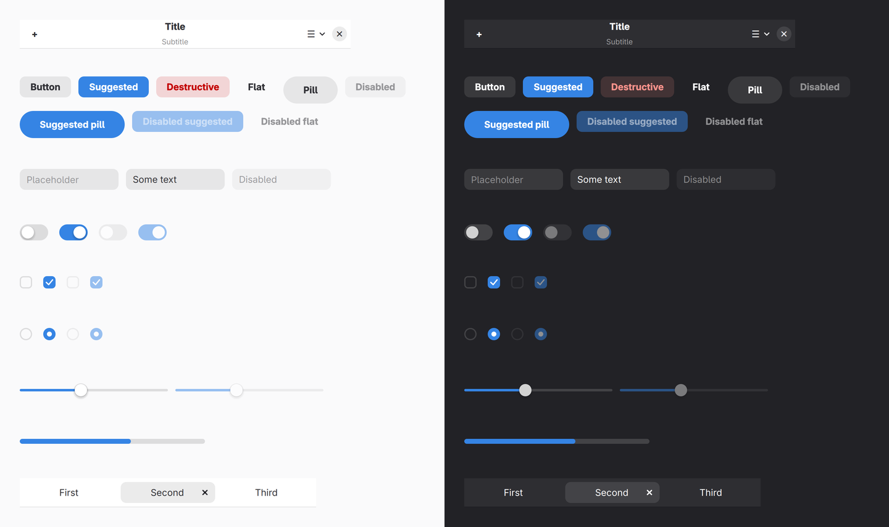
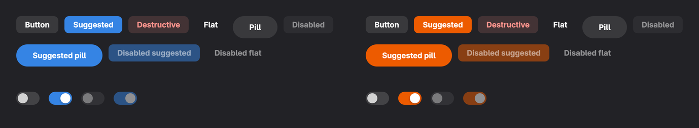
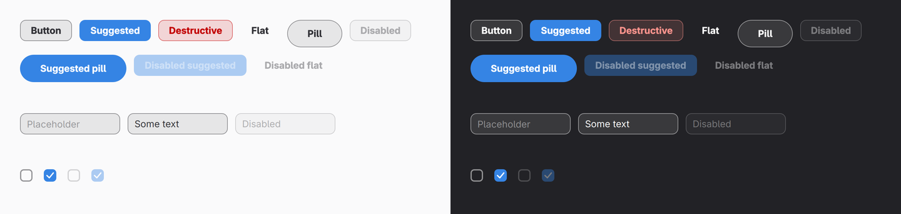

<div align="center">

# qt-libadwaita

**Make Qt apps look like they belong on GNOME.**

A Qt style plugin that draws Qt 6 and Qt 5 widgets the way libadwaita 1.10 (GNOME 51) does:
light and dark, nine accent colours, high contrast, all following your desktop settings live.




</div>

## Why

Qt apps on GNOME (or on a GNOME-styled KDE desktop) stick out: different buttons, different lists, different
menus. Existing Qt themes imitate the old GTK 3 Adwaita. This one follows **current libadwaita**: its colours are
generated from libadwaita's own stylesheet tokens, and every widget is checked against screenshots of real GTK 4
widgets (see [docs/compare/REPORT.md](docs/compare/REPORT.md)).

## Features

- **The libadwaita look**: rounded buttons and pills, flat entries, switches, rounded list rows, overlay scroll
  bars that fade out, popover-style menus with soft shadows, AdwTabBar tabs, header bars and boxed lists.
- **Follows the desktop**: light/dark, accent colour and high contrast come from the XDG desktop portal (GNOME)
  or the KDE colour scheme (Plasma), and switch live without restarting apps.
- **Qt 6 and Qt 5** from the same sources; public Qt API only, so one build loads in any newer Qt 6.
- **KDE colour schemes** included (Libadwaita, Libadwaita Dark and both high-contrast variants), so KDE apps such
  as Dolphin and Kate paint their sidebars and views in the same colours.
- **GTK behaviour where it matters**: mnemonic underlines only while Alt is held, focus rings only from the
  keyboard, Adwaita Sans as the UI font.
- **Adjustable**: spacing (compact to comfortable) and font size, for layouts that were not designed for GNOME
  metrics.
- **Flatpak apps** too: the installer shares the plugin with Flatpak apps through a user override.


<table>
<tr>
<td width="50%"><br><sub>Accent colours follow the system setting</sub></td>
<td width="50%"><br><sub>High contrast, light and dark</sub></td>
</tr>
</table>

## Install

### Build from source

Needs CMake, a C++17 compiler and Qt 6 (or Qt 5.15) development packages.

```sh
cmake -S . -B build -DCMAKE_INSTALL_PREFIX=$HOME/.local
cmake --build build -j4
cmake --install build
```

For Qt 5 apps, build a second copy with `-DQT_MAJOR=5`:

```sh
cmake -S . -B build-qt5 -DQT_MAJOR=5 -DCMAKE_INSTALL_PREFIX=$HOME/.local
cmake --build build-qt5 -j4 && cmake --install build-qt5
```

Details, distro plugin paths and the immutable KDE Linux route: [INSTALL.md](INSTALL.md) and
[docs/install-kde-linux.md](docs/install-kde-linux.md).

### Turn it on

| Where | How |
|---|---|
| KDE Plasma | System Settings > Colours & Themes > Application Style: **Libadwaita**, and Colours: **Libadwaita** or **Libadwaita Dark** |
| One app | `QT_STYLE_OVERRIDE=Libadwaita myapp` or `myapp -style Libadwaita` |
| Whole session | `QT_STYLE_OVERRIDE=Libadwaita` in `~/.config/environment.d/qt.conf` |

KDE apps also need the matching colour scheme, because they paint their content areas from it:

```sh
mkdir -p ~/.local/share/color-schemes && cp kde-colors/*.colors ~/.local/share/color-schemes/
```

## Configure

Everything follows the desktop by default. To override, use `~/.config/qt-libadwaita.conf`:

```ini
[General]
spacing=comfortable   # compact | normal | comfortable | any number 0.5-3
font-size=11          # Adwaita Sans size; default 10, 11 = exact GNOME size, 0 = keep the app's font
```

or environment variables:

| Variable | Values |
|---|---|
| `ADWAITA_COLOR_SCHEME` | `light`, `dark` |
| `ADWAITA_ACCENT` | `blue`, `teal`, `green`, `yellow`, `orange`, `red`, `pink`, `purple`, `slate`, `#rrggbb` |
| `ADWAITA_HIGH_CONTRAST` | `0`, `1` |
| `ADWAITA_ANIMATIONS` | `0`, `1` |
| `ADWAITA_SPACING`, `ADWAITA_FONT_SIZE` | as in the config file |
| `ADWAITA_KEEP_APP_PALETTE`, `ADWAITA_KEEP_APP_FONT` | `1` keeps the app's own palette or font |

## For app developers

Widgets can ask for GTK style classes through a dynamic property:

```cpp
saveButton->setProperty("adwaita-class", "suggested-action");   // accent button
deleteButton->setProperty("adwaita-class", "destructive-action");
toggle->setProperty("adwaita-switch", true);                     // QCheckBox drawn as a switch
```

Also available: `flat`, `pill`, `headerbar`, `boxed-list` / `boxed-row`. Without them apps still get the
libadwaita look; the classes only add the variants GTK apps choose explicitly. Full table in [INSTALL.md](INSTALL.md).

## Tested with

Dolphin, Kate, qBittorrent, VLC (Qt 5), OBS Studio (menus and dialogs; OBS draws the rest with its own theme) and
Kinoklip. Telegram Desktop links Qt statically and ignores style plugins.

## How close is it?

[`tools/compare/run.sh`](tools/compare) renders every widget with this style and with real GTK 4 / libadwaita,
in four schemes and two accents, and scores the difference. Current results and the known gaps are in
[docs/compare/REPORT.md](docs/compare/REPORT.md) and [docs/final-report.md](docs/final-report.md). The main ones:
no backdrop (unfocused window) state yet, and window title bars come from the window manager, not the style.

## Credits

Small helpers adapted from [adwaita-qt](https://github.com/FedoraQt/adwaita-qt) and
[Breeze](https://invent.kde.org/plasma/breeze); settings handling informed by
[QGnomePlatform](https://github.com/FedoraQt/QGnomePlatform). Colours and metrics come from
[libadwaita](https://gitlab.gnome.org/GNOME/libadwaita). Not affiliated with GNOME or KDE.

## License

GPL-2.0-or-later, see [COPYING](COPYING).
